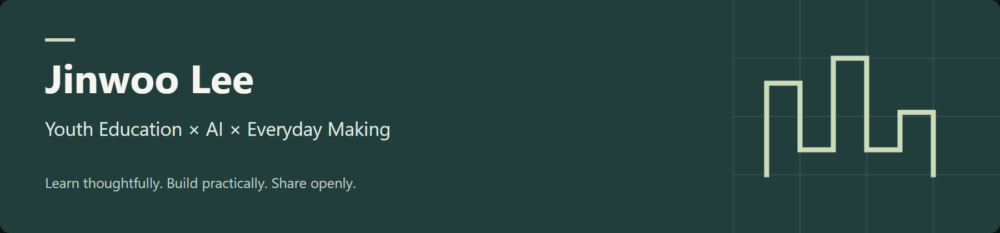

# 이진우 · Jinwoo Lee

**청소년교육 × AI 활용 × 바이브코딩**

청소년의 일상과 배움에 도움이 되는 아이디어를 기획하고, AI와 함께 실제로 만들어 봅니다.  
만드는 과정에서 배운 것은 글과 콘텐츠로 기록합니다.

[Portfolio](https://jinwoo-portfolio-navy.vercel.app/) · [Blog](https://blog.naver.com/jinus_02) · [Instagram](https://www.instagram.com/jinus_02/)

## 만들고 기록한 것

### 개인 포트폴리오
[이진우 포트폴리오](https://jinwoo-portfolio-navy.vercel.app/)  
청소년·교육·보건 분야의 활동과 기획 경험을 정리한 웹 포트폴리오입니다. 활동 사례, 이력과 프로젝트를 한곳에 담았습니다.

### 청소년 휴머니티 × AI 공동체 프로그램
[프로젝트 소개](https://jinwoo-portfolio-navy.vercel.app/projects)  
청소년이 나에서 시작해 타인, 주변, AI로 시선을 넓혀 가는 활동 프로그램입니다. AI로 아이디어와 활동지의 여러 버전을 탐색하고, 청소년의 눈높이와 안전을 기준으로 직접 검토합니다.

## 관심을 두는 일

- **청소년교육·상담**: 청소년의 참여와 관계, 배움을 돕는 활동 기획
- **AI 활용**: 자료 탐색, 아이디어 확장, 교육·콘텐츠 제작에 AI 연결하기
- **바이브코딩**: 일상과 현장에서 필요한 작은 웹 도구 만들어 보기
- **기록과 공유**: 활동 회고, 독서 기록, 직접 시도한 과정 나누기

## 배우고 있는 것

DHU에서 "청소년교육상담학과 보건관리학"을 함께 공부합니다.  
넓고 깊이있는 공부를 지향합니다.
가르침을 주실 선생님을 모십니다. 

## 글과 콘텐츠

[AI 활용과 청소년교육](https://blog.naver.com/jinus_02)  
AI 활용, 청소년교육, 독서와 활동의 경험을 기록합니다.

## Connect

- [Portfolio](https://jinwoo-portfolio-navy.vercel.app/)
- [Blog](https://blog.naver.com/jinus_02)
- [Instagram · @jinus_02](https://www.instagram.com/jinus_02/)
